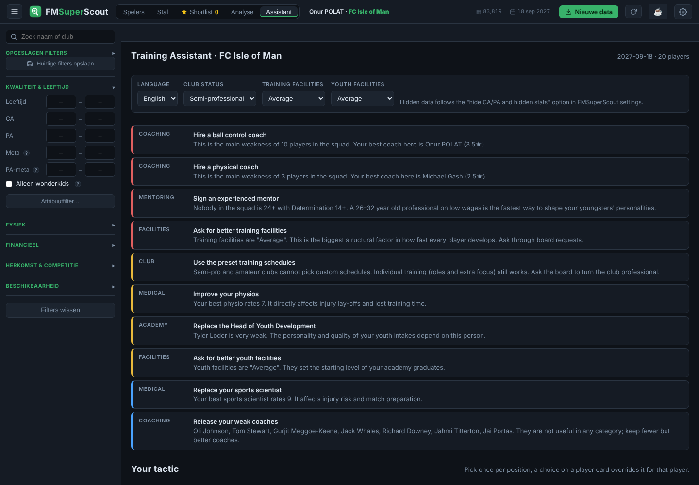
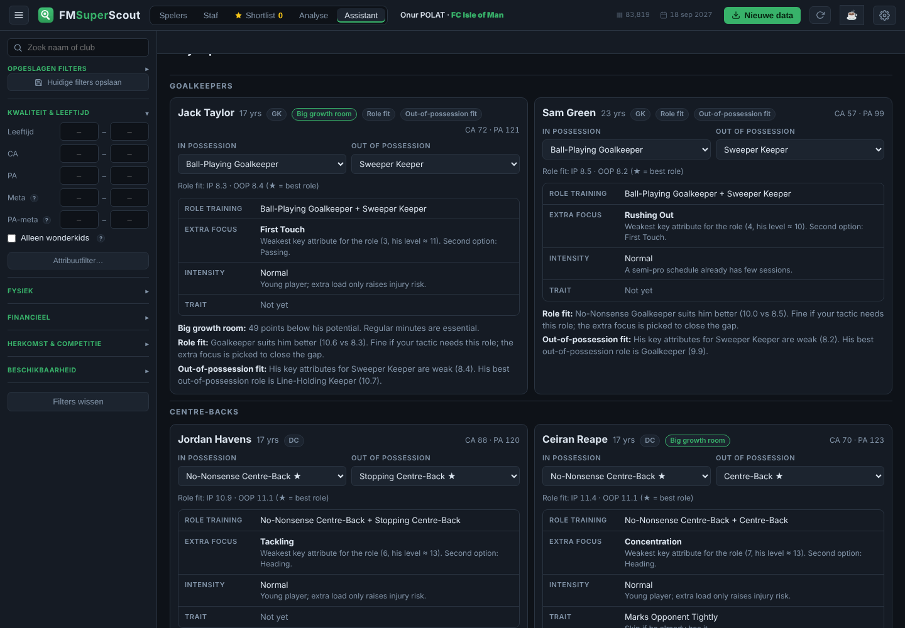

# FM26 Training Assistant

**English** · [Türkçe](README.tr.md)

A training, mentoring and coaching-staff advisor for **Football Manager 26**. It runs as an extra **Assistant** tab inside [FMSuperScout](https://github.com/mavarobli/FMSuperScout).

Press F9 in your save. The assistant reads your own squad and staff from the FMSuperScout dump and tells you, player by player:

- which **role training** to set for the in-possession and out-of-possession slots, based on the roles in your tactic
- which **extra focus** attribute closes the biggest gap for that role
- what **training intensity** suits the player's age and fitness
- which **player trait** fits his role once his attributes support it
- who should be **loaned out** to get minutes

Then for the whole club:

- **mentoring groups**: who mentors whom, and who to keep away from your youngsters
- the **coaching staff** split across training categories, with an estimated star rating per category
- a **priority list**: which coach to hire, which coaches to let go, and when to ask the board for better facilities

No API key, no internet connection and no account. Everything is rule based and runs locally in FMSuperScout.





## Install

1. Install [FMSuperScout](https://github.com/mavarobli/FMSuperScout/releases/latest) first and check that it works (F9 in game loads your players).
2. Download `FM26-Training-Assistant.zip` from the [latest release](../../releases/latest).
3. Right-click the zip and choose **Extract All**. Do not run the files from inside the zip; `Install.cmd` stops with a message if you do.
4. Double-click **`Install.cmd`** and answer **Yes** to the administrator prompt. FMSuperScout lives in Program Files, so writing there needs admin rights.
5. Restart FMSuperScout. An **Assistant** tab appears next to "Analyse".

If FMSuperScout updates itself, the tab may disappear. Run `Install.cmd` again. To remove the tab, run `Uninstall.cmd`.

If the installer fails, open an issue and paste the contents of `install-log.txt`.

<details>
<summary>Manual install</summary>

1. Copy `assistant.js` to `C:\Program Files\FMSuperScout\app\`.
2. Open `index.html` in that folder with Notepad (run Notepad as administrator).
3. Directly below `<script src="app.js"></script>`, add this line and save:
   ```html
   <script src="assistant.js"></script>
   ```

</details>

## Use

1. Load your save in FM26 and press **F9**.
2. Open the **Assistant** tab in FMSuperScout.
3. Set the language (English / Türkçe), your **club status** and your **facility levels** once. Club status matters because semi-pro and amateur clubs cannot use custom training schedules.
4. In **Your tactic**, pick the IP and OOP role for each position. For example, *Ball-Playing Goalkeeper* + *Sweeper Keeper* for your keeper. Every player in that position is then planned for those roles. A role picked on a player's card overrides the tactic for that player only.
5. Apply the advice in game yourself. The assistant never writes to the game or your save.

The tab refreshes automatically every time you press F9.

### Hidden data

The assistant follows FMSuperScout's own **"hide CA/PA and hidden stats"** setting:

- **Off** (hidden data used): advice also uses real PA, professionalism and injury proneness. You get flags such as "Big growth room" or "At his ceiling".
- **On** (realistic mode): advice uses only what a manager could know in game, mostly visible attributes and Determination. Depth charts are based on role fit instead of CA.

## How the advice works

| Advice | Rule |
|---|---|
| Best role | Weighted average of the role's key attributes (×2) and preferred attributes (×1) on the 1–20 scale |
| Extra focus | The key attribute furthest below the player's own level for the chosen IP + OOP roles. Strength is played down for teenagers because it grows naturally. Pace, Acceleration and Agility are pushed up to age 21. Physical focus is played down from 25. |
| Intensity | Low for injury-prone players (hidden), High with Natural Fitness 14+, Normal for youngsters and veterans |
| Loan | Age ≤ 20 and not in the typical starting XI for his position group (with hidden data on, also 25+ points of potential left) |
| Mentoring | Mentors are 21+ with Determination 13+ (and professionalism 15+ when hidden data is on). Mentees are youngsters with the lowest Determination first. Players with low Determination or professionalism are kept out of groups. |
| Coach stars | Per category: the relevant coaching attribute plus Determination and Motivating, scaled to 5 stars. Each coach covers at most two categories. |
| Hire / release | The categories where most players have their main weakness and the coaching is weakest. Coaches who are below about 2★ in every category. |

The FM26 role list follows the game. The key and preferred attributes per role, the star formula and all thresholds are **estimates** based on community knowledge, not Sports Interactive's hidden formulas. If your in-game stars or role suitability disagree, please open an issue with a screenshot.

**Known limitations:**
- FMSuperScout cannot fully read goalkeeping-coach attributes from memory, so the goalkeeping row is marked *estimated*.
- Turkish role names are taken from the game's Turkish tactics screen, with the English name shown next to them. If a patch renames one, fix it in the `role` list in `src/i18n.js` or open an issue.

## Development

Requires Node.js 20+. There are no dependencies.

```bash
npm test          # engine tests (node:test)
node build.js     # writes dist/assistant.js
```

| Path | Contents |
|---|---|
| `src/engine.js` | Rule engine: roles, focus, intensity, traits, mentoring, staff, priorities. Pure functions, no DOM. |
| `src/i18n.js` | Every user-facing string, in English and Turkish |
| `src/ui.js` | The FMSuperScout tab: adds the tab and reads FMSuperScout's `state` |
| `installer/` | `Install.cmd` / `Uninstall.cmd` and `install.ps1` |
| `test/` | Engine tests with a synthetic squad |

To try a change, copy `dist/assistant.js` over the installed one in `C:\Program Files\FMSuperScout\app\` and reload FMSuperScout.

**Adding a language:** copy the `en` block in `src/i18n.js`, translate it, and add the option to the language picker in `src/ui.js`. The tests check that every language has the same keys.

**Releasing:** push a tag such as `v1.0.1`. GitHub Actions runs the tests, builds the bundle and attaches the zip to a new release.

## Credits

- [FMSuperScout](https://github.com/mavarobli/FMSuperScout) by mavarobli does the hard part of reading the game's memory. This project only adds a tab on top of it.
- The FM26 role list follows the game's in-possession and out-of-possession roles, as listed by [FM Sidekick](https://fmsidekick.com/database/roles/all).

## Disclaimer

Unofficial and not affiliated with FMSuperScout, Sports Interactive or SEGA. For personal, single-player use. Football Manager is a trademark of Sports Interactive.

## License

[MIT](LICENSE)
