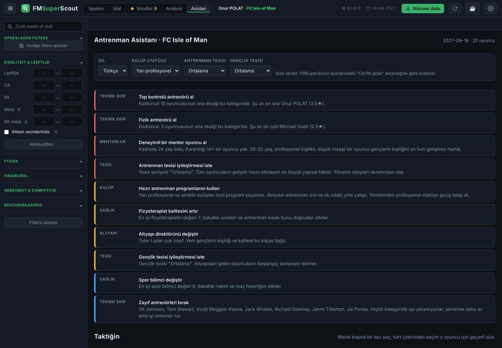
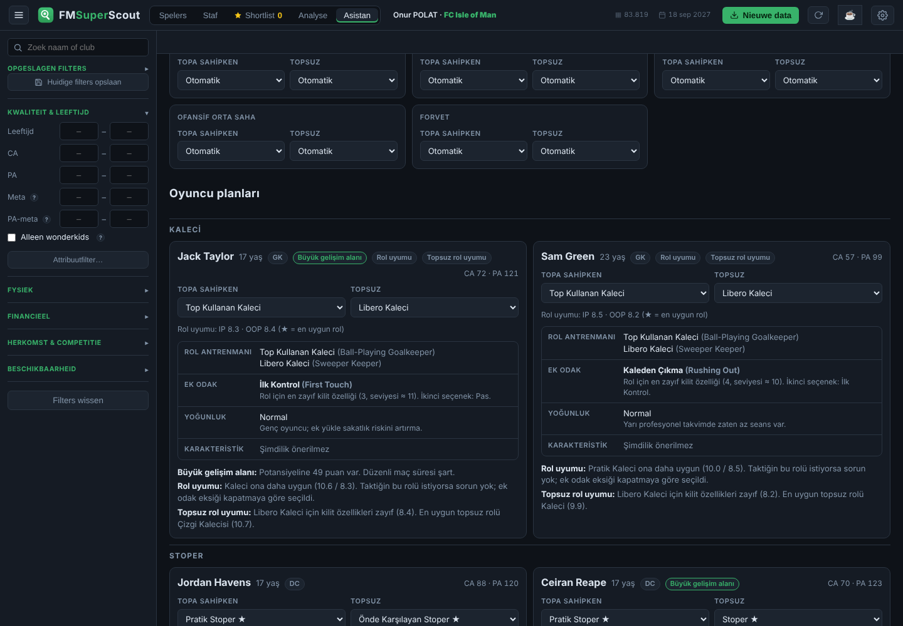

# FM26 Antrenman Asistanı

[English](README.md) · **Türkçe**

**Football Manager 26** için antrenman, mentorluk ve teknik ekip danışmanı. [FMSuperScout](https://github.com/mavarobli/FMSuperScout) içinde ek bir **Asistan** sekmesi olarak çalışır.

Kaydında F9'a basarsın. Asistan FMSuperScout dökümünden kendi kadronu ve teknik ekibini okur ve oyuncu oyuncu şunları söyler:

- taktiğindeki rollere göre topa sahipken ve topsuz slotlara hangi **rol antrenmanının** konacağı
- o rol için en büyük eksiği kapatan **ek odak** özelliği
- oyuncunun yaşına ve kondisyonuna uygun **antrenman yoğunluğu**
- özellikleri yettiğinde rolüne uyan **oyun karakteristiği**
- maç süresi için **kiralık** gönderilmesi gerekenler

Kulübün geneli için de şunları verir:

- **mentorluk grupları**: kim kime mentorluk yapsın, kim gençlerden uzak tutulsun
- **teknik ekibin** antrenman kategorilerine dağılımı ve kategori başına tahmini yıldız
- **öncelik listesi**: hangi antrenörü almalı, hangilerini bırakmalı, yönetimden ne zaman tesis iyileştirmesi istemeli

API anahtarı, internet bağlantısı ya da hesap gerekmez. Her şey kural tabanlıdır ve FMSuperScout içinde yerel olarak çalışır.





## Kurulum

1. Önce [FMSuperScout](https://github.com/mavarobli/FMSuperScout/releases/latest)'u kur ve çalıştığından emin ol (oyunda F9 oyuncuları yükleyebilmeli).
2. [Son sürümden](../../releases/latest) `FM26-Training-Assistant.zip` dosyasını indir.
3. Zip'e sağ tıkla ve **Tümünü ayıkla** de. Dosyaları zip'in içinden çalıştırma; çalıştırırsan `Install.cmd` bir uyarıyla durur.
4. **`Install.cmd`** dosyasına çift tıkla, yönetici izni penceresine **Evet** de. FMSuperScout Program Files altında olduğu için oraya yazmak yönetici izni ister.
5. FMSuperScout'u yeniden aç. "Analyse"in yanında **Asistan** sekmesi çıkar.

FMSuperScout kendini güncellerse sekme kaybolabilir. `Install.cmd`'yi tekrar çalıştırman yeterli. Sekmeyi kaldırmak için `Uninstall.cmd`'yi çalıştır.

Kurulum hata verirse bir issue aç ve `install-log.txt` içeriğini yapıştır.

<details>
<summary>Elle kurulum</summary>

1. `assistant.js` dosyasını `C:\Program Files\FMSuperScout\app\` klasörüne kopyala.
2. Aynı klasördeki `index.html` dosyasını Not Defteri ile aç (Not Defteri'ni yönetici olarak çalıştır).
3. `<script src="app.js"></script>` satırının hemen altına şu satırı ekle ve kaydet:
   ```html
   <script src="assistant.js"></script>
   ```

</details>

## Kullanım

1. FM26'da kaydını yükle ve **F9**'a bas.
2. FMSuperScout'ta **Asistan** sekmesini aç.
3. Dili (English / Türkçe), **kulüp statünü** ve **tesis seviyelerini** bir kez seç. Kulüp statüsü önemli, çünkü yarı profesyonel ve amatör kulüpler özel antrenman programı kullanamaz.
4. **Taktiğin** bölümünde her mevki için IP ve OOP rolünü seç. Örneğin kalecin için *Ball-Playing Goalkeeper* + *Sweeper Keeper*. O mevkideki tüm oyuncular bu rollere göre planlanır. Oyuncu kartında seçtiğin rol, taktiği sadece o oyuncu için geçersiz kılar.
5. Önerileri oyunda kendin uygula. Asistan oyuna ya da kayıt dosyasına hiçbir şey yazmaz.

Sekme her F9'da kendiliğinden yenilenir.

### Gizli veriler

Asistan, FMSuperScout'un kendi **"CA/PA ve gizli değerleri gizle"** ayarına uyar:

- **Kapalı** (gizli veriler kullanılır): öneriler gerçek PA, profesyonellik ve sakatlık eğilimini de kullanır. "Büyük gelişim alanı" ya da "Tavanına ulaştı" gibi uyarılar görünür.
- **Açık** (gerçekçi mod): öneriler sadece bir menajerin oyunda bilebileceği verilerle yapılır, ağırlıkla görünür özellikler ve Kararlılık. Kadro derinliği CA yerine rol uyumuna göre hesaplanır.

## Öneriler nasıl hesaplanıyor

| Öneri | Kural |
|---|---|
| En uygun rol | Rolün kilit özelliklerinin (×2) ve tercih edilen özelliklerinin (×1) 1–20 ölçeğinde ağırlıklı ortalaması |
| Ek odak | Seçili IP + OOP rolleri için oyuncunun kendi seviyesinin en altında kalan kilit özellik. Güç, gençlerde kendiliğinden geliştiği için geri planda tutulur. Hız, Hızlanma ve Çeviklik 21 yaşına kadar öne çıkarılır. Fiziksel odak 25 yaştan sonra geri planda tutulur. |
| Yoğunluk | Sakatlığa yatkın oyuncuda (gizli) Düşük, Doğal Kondisyon 14+ ise Yüksek, gençlerde ve yaşlılarda Normal |
| Kiralık | 20 yaş ve altı, mevki grubunda tipik ilk 11'de değil (gizli veriler açıksa potansiyeline en az 25 puan da olmalı) |
| Mentorluk | Mentorlar 21+ yaş, Kararlılık 13+ (gizli veriler açıksa profesyonellik de 15+). Gençler en düşük Kararlılıktan başlayarak eşleşir. Kararlılığı ya da profesyonelliği düşük oyuncular gruplara alınmaz. |
| Antrenör yıldızı | Kategori başına ilgili antrenörlük özelliği, Kararlılık ve Motivasyon; 5 yıldıza ölçeklenir. Her antrenör en fazla iki kategoriye bakar. |
| Al / bırak | En çok oyuncunun ana eksiğinin olduğu ve antrenörün en zayıf olduğu kategoriler. Her kategoride yaklaşık 2★'ın altında kalan antrenörler. |

FM26 rol listesi oyundakiyle aynıdır. Rol başına kilit ve tercih edilen özellikler, yıldız formülü ve tüm eşikler topluluk bilgisine dayanan **tahminlerdir**, Sports Interactive'in gizli formülleri değildir. Oyundaki yıldızlar ya da rol uygunluğu farklı çıkarsa ekran görüntüsüyle bir issue açabilirsin.

**Bilinen sınırlar:**
- FMSuperScout kaleci antrenörü özelliklerini bellekten tam okuyamıyor. Bu yüzden kaleci satırı *tahmini* olarak işaretli.
- Türkçe rol adları oyunun FM26 taktik ekranındaki Türkçe adlarıdır; yanlarında İngilizce adları da gösterilir. Bir FM yamasında değişen bir ad görürsen `src/i18n.js` içindeki `role` listesinden düzeltebilir ya da issue açabilirsin.

## Geliştirme

Node.js 20+ gerekir. Hiçbir bağımlılık yok.

```bash
npm test          # motor testleri (node:test)
node build.js     # dist/assistant.js üretir
```

| Yol | İçerik |
|---|---|
| `src/engine.js` | Kural motoru: roller, odak, yoğunluk, karakteristik, mentorluk, teknik ekip, öncelikler. Saf fonksiyonlar, DOM yok. |
| `src/i18n.js` | Kullanıcının gördüğü tüm metinler, İngilizce ve Türkçe |
| `src/ui.js` | FMSuperScout sekmesi: sekmeyi ekler ve FMSuperScout'un `state` nesnesini okur |
| `installer/` | `Install.cmd` / `Uninstall.cmd` ve `install.ps1` |
| `test/` | Sentetik bir kadroyla motor testleri |

Bir değişikliği denemek için `dist/assistant.js` dosyasını `C:\Program Files\FMSuperScout\app\` içindekinin üzerine kopyala ve FMSuperScout'u yenile.

**Dil eklemek:** `src/i18n.js` içindeki `en` bloğunu kopyala, çevir ve `src/ui.js`'teki dil seçicisine seçeneği ekle. Testler her dilde aynı anahtarların olduğunu kontrol eder.

**Sürüm çıkarmak:** `v1.0.1` gibi bir tag push et. GitHub Actions testleri çalıştırır, paketi derler ve zip'i yeni bir sürüme ekler.

## Teşekkürler

- Oyunun belleğini okuma işini mavarobli'nin [FMSuperScout](https://github.com/mavarobli/FMSuperScout)'u yapıyor. Bu proje sadece onun üstüne bir sekme ekliyor.
- FM26 rol listesi, oyunun topa sahipken ve topsuz rollerini izler; kaynak [FM Sidekick](https://fmsidekick.com/database/roles/all).

## Yasal uyarı

Resmi değildir; FMSuperScout, Sports Interactive veya SEGA ile bağlantısı yoktur. Kişisel, tek oyunculu kullanım içindir. Football Manager, Sports Interactive'in ticari markasıdır.

## Lisans

[MIT](LICENSE)
